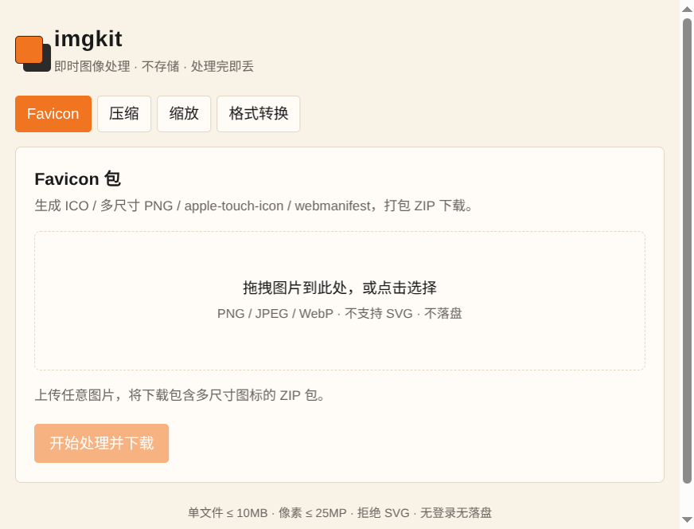

<div align="center">

# imgkit

**即时图像处理 · 不存储 · 处理完即丢**

FastAPI + Vue3 单进程 · 图像处理 / 码生成与扫描 · 无登录无落盘

[](https://www.python.org/)
[](https://fastapi.tiangolo.com/)
[](https://vuejs.org/)
[](https://antdv.com/)
[](https://python-pillow.org/)
[](./LICENSE)

</div>

> 本地或内网随手起一个图像小工具：上传即处理、结果先预览再下载，全程内存、不写磁盘、不需要账号。

---

## 目录

- [界面预览](#界面预览)
- [特性](#特性)
- [技术栈](#技术栈)
- [目录结构](#目录结构)
- [环境依赖](#环境依赖)
- [快速开始](#快速开始)
- [Docker](#docker)
- [API 一览](#api-一览)
- [安全说明](#安全说明)
- [常用命令](#常用命令)
- [许可证](#许可证)

## 界面预览

<table>
  <tr>
    <td width="50%"></td>
    <td width="50%"></td>
  </tr>
  <tr>
    <td align="center">Favicon 包</td>
    <td align="center">图像压缩</td>
  </tr>
</table>

## 特性

### 基础处理

- **Favicon 包**：ICO（16/32/48）+ 多尺寸 PNG + apple-touch-icon + `site.webmanifest` → ZIP
- **压缩**：可调 `quality` / 输出格式 / 最长边；默认剥离 EXIF
- **缩放**：最长边或宽×高；`contain` / `cover` / `stretch`
- **格式转换**：WebP / JPEG / PNG（JPEG 透明区域铺白底）

### 图像组合

- **拼接**：多图水平 / 垂直；排序、边距、间距、对齐、背景色（最多 20 张）
- **九宫格**：可配行列（2–6），余数像素归入右下侧格子 → ZIP
- **取色**：中位切分量化提取主色（2–16 色），返回 HEX / RGB / 占比

### 码生成与扫描

- **二维码生成**：文本 / URL；模块大小、边框、容错级别（L/M/Q/H）
- **条形码生成**：Code128 / Code39 / EAN-13 / EAN-8 / UPC-A / ISBN-13
- **扫二维码 / 扫条形码**：浏览器本地解码（ZXing）；支持上传图片或摄像头

### 产品形态

- **先预览再下载**：图像结果可预览；ZIP 可展开包内缩略图后再下载
- **单进程**：`make run` 构建前端并由 Uvicorn 一并托管
- **无登录无落盘**：上传与结果只在内存中流转

## 技术栈

| 层 | 选型 |
|----|------|
| API | Python · FastAPI · Uvicorn · Pillow · qrcode · python-barcode |
| 前端 | Vue 3 · Vite · TypeScript · Ant Design Vue · ZXing · JSZip |
| 部署 | 单进程静态挂载（`app/static`） |

## 目录结构

```text
app/
  main.py            FastAPI 入口（API + 静态托管）
  config.py          上传 / 限流 / 业务上限
  middleware.py      安全头、限流、流式读上传
  api/               HTTP 路由
  services/          图像与码处理逻辑（全程内存）
  static/            前端构建产物（make build 生成）
web/
  src/               Vue3 源码（侧栏布局、预览、扫描）
  package.json       前端依赖
docs/screenshots/    README 截图
Makefile             install / build / run / clean
Dockerfile           多阶段镜像构建
docker-compose.yml   一键启动
requirements.txt     Python 依赖
```

## 环境依赖

| 依赖 | 说明 |
|------|------|
| Python 3.11+ | 后端 |
| Node 20+ / pnpm | 前端构建 |
| Make | 可选，便于一键命令 |

## 快速开始

```bash
git clone git@github.com:jiangbyte/imgkit.git
cd imgkit

make install   # pip + pnpm
make run       # 构建前端并启动
```

浏览器打开：**http://127.0.0.1:8787/**

仅启 API（前端需已构建，或另开 `cd web && pnpm dev` 走 Vite 代理）：

```bash
make build
make dev-api
```

## Docker

多阶段构建：Node 构建前端 → Python 精简镜像运行（监听 `8787`）。

```bash
# 本机调试
docker compose up --build

# 或
docker build -t imgkit:latest .
docker run --rm -p 8787:8787 imgkit:latest
```

浏览器打开：**http://127.0.0.1:8787/**

镜像内以非 root 用户运行；处理全程内存，无需挂载数据卷。

### 接 nginx-gateway（子域反代）

imgkit **单进程**同时提供页面与 `/api`，网关整站反代到容器 `8787` 即可（不必拆前后端）。

1. **DNS**：`imgkit.jiangbyte.cn` → 服务器 IP（证书需覆盖该子域，例如 `*.jiangbyte.cn`）。
2. **确认网关网络名**：

```bash
docker network ls
# 常见为 nginx-gateway，按实际修改 deploy/docker-compose.gateway.yml
```

3. **启动容器并加入网关网络**：

```bash
cd /path/to/imgkit
# 先按实际改 deploy/docker-compose.gateway.yml 里的 networks.name
docker compose -f deploy/docker-compose.gateway.yml up -d --build
```

4. **放入 Nginx 配置**（仓库内模板：`deploy/imgkit.conf`）：

```bash
cp deploy/imgkit.conf /opt/nginx-gateway/conf.d/imgkit.conf
# 如网关容器名不是 nginx，按你的方式 reload，例如：
docker exec nginx-gateway nginx -t && docker exec nginx-gateway nginx -s reload
```

要点：

| 项 | 说明 |
|----|------|
| `proxy_pass` | `http://imgkit:8787`（容器名 + 端口，**不要**尾斜杠乱改路径） |
| `client_max_body_size` | ≥ 12m（服务端上传硬限 10MB） |
| 限流 | 应用内按直连 IP 限流；经网关时可能看到的是网关 IP，公网请在 Nginx / 边缘再做限流 |

访问：**https://imgkit.jiangbyte.cn/**

## API 一览

除特别说明外，均为 **POST** + `multipart/form-data`。上传图字段名一般为 `file`（拼接为 `files`），输入仅 **PNG / JPEG / WebP**（拒绝 SVG）。输出格式一般为 `webp` / `jpeg` / `png`。

| 能力 | 路径 | 主要参数 |
|------|------|----------|
| Favicon | `/api/favicon` | `file` → ZIP |
| 压缩 | `/api/compress` | `quality` · `format` · `max_edge` · `keep_exif` |
| 缩放 | `/api/resize` | `mode` · `max_edge` / `width`·`height` · `fit` · `format` · `quality` |
| 转换 | `/api/convert` | `format` · `quality` · `max_edge` |
| 拼接 | `/api/stitch` | `files`（≥2）· `direction` · `sort` · `margin` · `gap` · `align` · `bgcolor` · `format` · `quality` |
| 九宫格 | `/api/grid` | `rows` · `cols` · `format` · `quality` → ZIP |
| 取色 | `/api/colors` | `count` → `{ "colors": [{ "hex", "rgb", "ratio" }] }` |
| 二维码 | `/api/qrcode` | `content` · `box_size` · `border` · `error_correction` · `format` · `quality`（无文件） |
| 条形码 | `/api/barcode` | `content` · `barcode_type` · `write_text` · `format` · `quality`（无文件） |
| 健康检查 | `GET /api/health` | — |

说明：

- 二维码 / 条形码扫描在**浏览器本地**完成，无对应服务端 API。
- 错误体：`{ "code", "message" }`（不回堆栈）。

### 常用参数取值

| 参数 | 取值 |
|------|------|
| `direction` | `horizontal` / `vertical` |
| `sort` | `original` / `name_asc` / `name_desc` / `size_asc` / `size_desc` |
| `align` | `start` / `center` / `end` |
| `fit` | `contain` / `cover` / `stretch` |
| `error_correction` | `L` / `M` / `Q` / `H` |
| `barcode_type` | `code128` / `code39` / `ean13` / `ean8` / `upc` / `isbn13` |

## 安全说明

- 单文件 ≤ **10MB**，像素 ≤ **25MP**，输出最长边 ≤ **8192**；流式读上传，超限即断
- 魔数校验；拒绝 SVG / 未知类型；下载文件名由服务端生成
- 拼接最多 **20** 张；九宫格行列 **2–6**；取色 **2–16** 色
- 按 IP **进程内**限流（默认 60 次/分钟）；**不信任** `X-Forwarded-For`
- 安全头：`X-Content-Type-Options` / `X-Frame-Options` / `Referrer-Policy` / `CSP`
- 扫描页允许本页调用摄像头（`Permissions-Policy: camera=(self)`）
- 关闭 Swagger / OpenAPI 文档页

公网暴露时请加反向代理、TLS，并在边缘再做限流 / WAF；本服务无账号体系。

## 常用命令

| 命令 | 说明 |
|------|------|
| `make install` | 安装 Python 与前端依赖 |
| `make build` | 构建前端到 `app/static` |
| `make run` | 构建并启动（`0.0.0.0:8787`） |
| `make dev-api` | 仅 API，带 reload |
| `make clean` | 清理构建产物与 `node_modules` |

## 许可证

[MIT](./LICENSE) © jiangbyte
