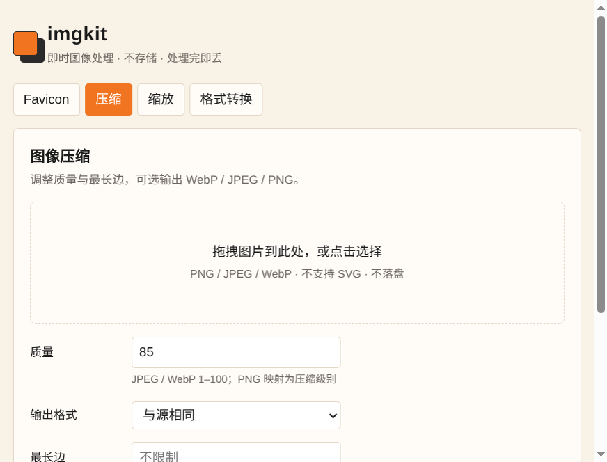

<div align="center">

# imgkit

**即时图像处理 · 不存储 · 处理完即丢**

FastAPI + Vue3 单进程 · Favicon / 压缩 / 缩放 / 格式转换 · 无登录无落盘

[](https://www.python.org/)
[](https://fastapi.tiangolo.com/)
[](https://vuejs.org/)
[](https://python-pillow.org/)
[](./LICENSE)

</div>

> 本地或内网随手起一个图像小工具：上传即处理、结果直接下载，全程内存、不写磁盘、不需要账号。

---

## 目录

- [界面预览](#界面预览)
- [特性](#特性)
- [技术栈](#技术栈)
- [目录结构](#目录结构)
- [环境依赖](#环境依赖)
- [快速开始](#快速开始)
- [API 一览](#api-一览)
- [安全说明](#安全说明)
- [常用命令](#常用命令)
- [许可证](#许可证)

## 界面预览

<table>
  <tr>
    <td width="50%"></td>
    <td width="50%"></td>
  </tr>
  <tr>
    <td align="center">Favicon 包</td>
    <td align="center">图像压缩</td>
  </tr>
</table>

## 特性

- **Favicon 包**：ICO（16/32/48）+ 多尺寸 PNG + apple-touch-icon + `site.webmanifest` → ZIP
- **压缩**：可调 `quality` / 输出格式 / 最长边；默认剥离 EXIF
- **缩放**：最长边或宽×高；`contain` / `cover` / `stretch`
- **格式转换**：WebP / JPEG / PNG（JPEG 透明铺白底）
- **单进程**：`make run` 构建前端并由 Uvicorn 一并托管，无需前后端分开起
- **无登录无落盘**：上传与结果只在内存中流转

## 技术栈

| 层 | 选型 |
|----|------|
| API | Python · FastAPI · Uvicorn · Pillow |
| 前端 | Vue 3 · Vite · TypeScript |
| 部署 | 单进程静态挂载（`app/static`） |

## 目录结构

```text
app/                 FastAPI 入口、API、处理逻辑
app/static/          Vue 构建产物（make build 生成）
web/                 Vue3 + Vite 前端源码
docs/screenshots/    README 截图
Makefile             install / build / run
requirements.txt     Python 依赖
```

## 环境依赖

| 依赖 | 说明 |
|------|------|
| Python 3.11+ | 后端 |
| Node 20+ / pnpm | 前端构建 |
| Make | 可选，便于一键命令 |

## 快速开始

```bash
git clone git@github.com:jiangbyte/imgkit.git
cd imgkit

make install   # pip + pnpm
make run       # 构建前端并启动
```

浏览器打开：**http://127.0.0.1:8787/**

仅启 API（前端需已构建，或另开 `cd web && pnpm dev` 走 Vite 代理）：

```bash
make build
make dev-api
```

## API 一览

一律 **POST** + `multipart/form-data`，字段名 `file` 为上传图。输入仅 **PNG / JPEG / WebP**（拒绝 SVG）。

| 能力 | 路径 | 主要参数 |
|------|------|----------|
| Favicon | `/api/favicon` | （仅文件） |
| 压缩 | `/api/compress` | `quality` · `format` · `max_edge` · `keep_exif` |
| 缩放 | `/api/resize` | `mode` · `max_edge` / `width`·`height` · `fit` · `format` · `quality` |
| 转换 | `/api/convert` | `format` · `quality` · `max_edge` |
| 健康检查 | `GET /api/health` | — |

错误体：`{ "code", "message" }`（不回堆栈）。

## 安全说明

- 单文件 ≤ **10MB**，像素 ≤ **25MP**；流式读上传，超限即断
- 魔数校验；拒绝 SVG / 未知类型；下载文件名由服务端生成
- 按 IP **进程内**限流（默认 60 次/分钟）；**不信任** `X-Forwarded-For`
- 安全头：`X-Content-Type-Options` / `X-Frame-Options` / `Referrer-Policy` / `CSP`
- 关闭 Swagger / OpenAPI 文档页

公网暴露时请加反向代理、TLS，并在边缘再做限流 / WAF；本服务无账号体系。

## 常用命令

| 命令 | 说明 |
|------|------|
| `make install` | 安装 Python 与前端依赖 |
| `make build` | 构建前端到 `app/static` |
| `make run` | 构建并启动（`0.0.0.0:8787`） |
| `make dev-api` | 仅 API，带 reload |
| `make clean` | 清理构建产物与 `node_modules` |

## 许可证

[MIT](./LICENSE) © jiangbyte
